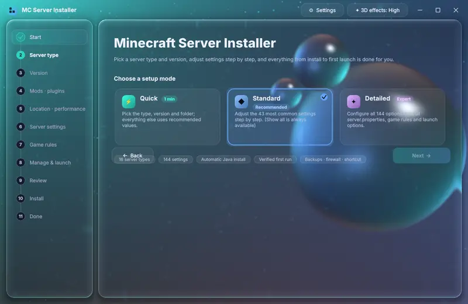
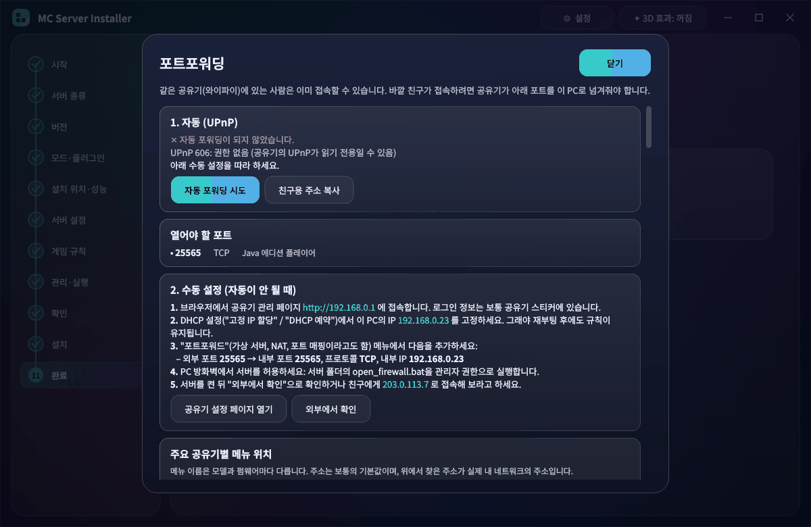

# MC Server Installer

[English](README.md) · **한국어**

마인크래프트 자바 에디션 서버를 단계별로 설치하는 데스크톱 프로그램입니다. 서버 종류와 버전을 고르고
원하는 만큼 설정을 바꾸면, 파일 다운로드와 설정 파일 작성, 공유기 포트 열기, 첫 실행 확인까지 알아서 합니다.



*서버 종류마다 고유한 애니메이션이 나옵니다. Paper는 종이비행기, CraftBukkit은 용암 양동이, Fabric은 천, Forge는 모루, Purpur는 블록, Arclight는 번개.*

## 기능

- **서버 16종**: Vanilla, Paper, Purpur, Folia, Spigot, Bukkit · Fabric, Quilt, Legacy Fabric, Babric,
  Forge, NeoForge · 하이브리드 Mohist, Youer, Arclight, Banner.
  버전과 빌드 목록은 각 프로젝트의 공식 API에서 실시간으로 받아옵니다.
- **설정 모드 3가지**: 빠른(종류·버전·폴더만), 중간(자주 쓰는 43개), 상세(`server.properties` 전체,
  게임 규칙, 실행 옵션까지 144개). 검색과 분류를 지원합니다.
- **버전별 처리**: 26.x 연도 방식 버전, 버전별 필요한 Java, 1.21.9에서 게임 규칙으로 옮겨진 항목,
  1.21.11부터의 snake_case 게임 규칙 이름을 자동으로 맞춥니다.
- **모드·플러그인**: Modrinth에서 내 로더와 버전에 맞는 것만 검색하고 필수 의존성을 자동으로 추가합니다.
  내 `.jar`/`.zip` 파일도 넣을 수 있습니다.
- **모드팩**: **Modrinth**와 **CurseForge** 모드팩을 앱에서 검색(아이콘, 태그, 다운로드 수, 업데이트 날짜,
  정렬)하거나 `.mrpack` / CurseForge `.zip` / 서버팩 파일을 열어 설치합니다. 버전·로더·모드는 팩에서 정해지고,
  클라이언트 전용 모드는 빠집니다. CurseForge는 제작자의 **서버팩**이 있으면 그걸 씁니다. 제작자가 외부 앱
  다운로드를 막은 모드는 링크와 함께 `MANUAL_DOWNLOADS.txt`에 정리됩니다.
- **Java**: 설치된 Java(마인크래프트 런처 포함)를 찾고, 없으면 Temurin JDK를 받아 줍니다.
- **포트포워딩**: 필요한 포트를 자동으로 엽니다(모든 네트워크 어댑터로 UPnP, 그다음 PCP / NAT-PMP, 그다음
  Windows 자체 UPnP 서비스). Windows 방화벽 규칙도 추가합니다. 공유기가 막혀 있으면 내 네트워크 값
  (공유기 주소, 이 PC의 IP, 포트와 프로토콜)이 채워진 12단계 그림 안내로 공유기 포트포워딩 규칙과
  Windows 방화벽 인바운드 규칙 직접 만들기를 보여 주고, 주요 공유기별 메뉴 위치와 이중 공유기·CGNAT 확인
  방법도 안내합니다.
- **편의 기능**: 자동 재시작 옵션이 있는 `start.bat`/`start.sh`, Aikar 플래그, 백업 스크립트,
  방화벽 스크립트, 바탕화면 바로가기, 서버 아이콘, OP·화이트리스트.
- **첫 실행 확인**: 서버를 한 번 켜서 콘솔로 게임 규칙·OP·화이트리스트를 적용한 뒤 정상 종료합니다.
- **언어**: English, 한국어, 日本語, 简体中文, Español.
- OpenGL 실시간 유리 배경(굴절, 입자, 서버 종류별 애니메이션). OpenGL을 쓸 수 없으면 2D 배경으로 바뀝니다.
- **업데이트 알림**: 새 버전이 나오면 알려 줍니다(⚙ 설정에서 끌 수 있음).
- **기간 한정 이벤트 로더**: 할로윈, 크리스마스, 새해, 발렌타인데이, 만우절, 세계 UFO의 날 즈음에만 나타나는
  장난용 "서버 종류"입니다. 각자 고유한 3D 애니메이션이 있고, 몇 번 클릭으로 설치되며 `start.bat`을 실행하면
  창이 떠서 짧은 3D 애니메이션이 나옵니다. *⚙ 설정 → 이벤트 로더 항상 보이기*를 켜면 언제든 볼 수 있습니다.

| 포트포워딩 안내 |
| --- |
|  |

## 다운로드

**[Releases](https://github.com/kwhitewew-star/mc-server-installer/releases/latest)**에서 최신 버전을 받으세요.

| 파일 | 설명 |
| --- | --- |
| `MC-Server-Installer-x.y.z.exe` | Windows 10/11용 파일 하나짜리. 더블클릭하면 바로 실행됩니다. |
| `MC-Server-Installer-x.y.z-portable.zip` | 폴더 버전. 압축을 풀고 `MC-Server-Installer.exe`를 실행하면 되며, 더 빨리 켜집니다. |
| `mc-server-installer-x.y.z-source.zip` | 소스 코드 (아래 참고). |

Java는 미리 없어도 됩니다. 설치기가 받아 줍니다.

### "Windows의 PC 보호" 창이 뜰 때

exe에 아직 코드 서명이 없어서, 처음 실행할 때 Microsoft Defender SmartScreen 경고가 뜹니다.

1. 파란색 "Windows의 PC 보호" 창에서 **추가 정보**를 누릅니다.
2. 아래에 나타나는 **실행** 버튼을 누릅니다.

일부 백신이 파일 하나짜리 파이썬 앱을 잘못 진단하는 경우도 있습니다. 그럴 때는 포터블 zip이나 소스
버전을 쓰시고, [Issues](https://github.com/kwhitewew-star/mc-server-installer/issues)에 알려 주세요.

## 소스로 실행

**Python 3.10 이상**이 필요합니다.

**Windows**: `run.bat`을 더블클릭하세요. 처음 실행할 때 필요한 패키지를 설치합니다.

**Linux / macOS**: `./run.sh`

**직접 실행**:

```bash
python -m pip install -r requirements.txt
python run.py            # 또는: python -m mcsi
```

기본 언어는 영어입니다. **⚙ 설정 → Language**에서 한국어로 바꿀 수 있습니다.
설정은 `~/.mc_server_installer/config.json`에 저장됩니다.

서버를 설치하면 [마인크래프트 EULA](https://aka.ms/MinecraftEULA)에 동의하는 것이며, 설치 전에 확인을 받습니다.

## 연결 테스트

버전 목록이 안 뜨면 `selftest.bat`(또는 `python scripts/selftest.py`)을 실행하세요. 모든 서버 종류의 API를
확인하고 결과를 `selftest_result.txt`에 저장합니다. 버그를 알릴 때 첨부하면 좋습니다.

## 피드백

버그를 찾았거나 아이디어가 있으면 [이슈를 남겨 주세요](https://github.com/kwhitewew-star/mc-server-installer/issues/new/choose). 버그 신고와 기능 제안 양식이 있고, 한국어로 써도 됩니다.

## 개발

```bash
python -m pip install -r requirements-dev.txt
python -m pytest
python scripts/screenshots.py ko      # 모든 화면을 오프스크린으로 돌며 잘림 확인
python scripts/i18n_sync.py           # 언어별 빠진 번역 확인
```

CurseForge API 키: 공식 빌드에는 앱 전용 키가 들어갑니다. console.curseforge.com에서 서드파티 키를 받아
저장소의 Actions 시크릿 **`CF_API_KEY`**에 넣으면 릴리스 빌드에만 들어가고 저장소에는 올라가지 않습니다.
자세한 내용은 [README.md](README.md#curseforge-api-key)를 보세요.

번역은 `mcsi/i18n/<언어>.json`에 있으며, 영어 원문을 키로 씁니다. 자세한 내용은 [README.md](README.md#translations)를 보세요.

## 라이선스

[MIT](LICENSE). 마인크래프트 공식 제품이 아니며 Mojang·Microsoft와 관계가 없습니다.
서버 소프트웨어는 각 프로젝트의 서버에서 내려받으며 각자의 라이선스를 따릅니다.
