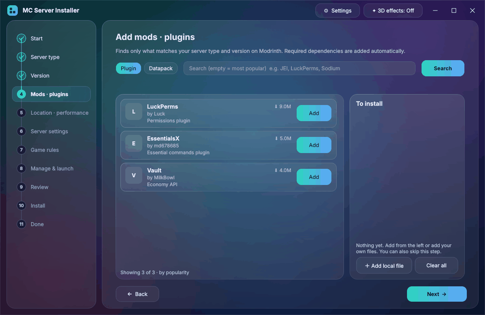
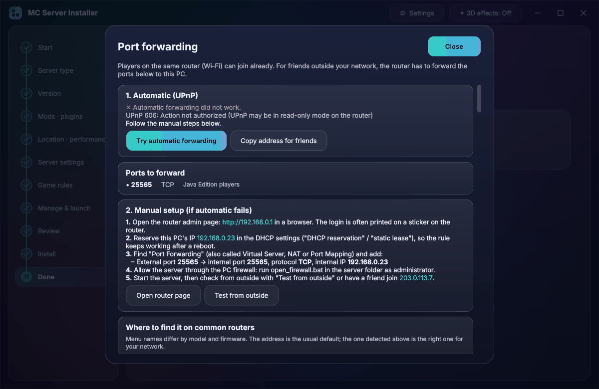

# MC Server Installer

**English** · [한국어](README.ko.md)

A step-by-step desktop installer for Minecraft Java Edition servers. You pick a server type and a version,
adjust as many or as few settings as you like, and it downloads everything, writes the config, opens your
router's port and starts the server once to check that it works.


*Each server type plays its own animation: Paper's paper plane, CraftBukkit's lava bucket, Fabric's cloth, Forge's anvil, Purpur's blocks, Arclight's lightning.*

## Features

- **16 server types**: Vanilla, Paper, Purpur, Folia, Spigot, Bukkit · Fabric, Quilt, Legacy Fabric, Babric,
  Forge, NeoForge · hybrids Mohist, Youer, Arclight, Banner.
  Version and build lists come live from each project's official API (Mojang, PaperMC Fill v3, Purpur,
  Fabric/Quilt meta, Forge/NeoForge Maven, MohistMC, GitHub releases).
- **Three setup modes**: Quick (type, version, folder), Standard (43 common settings) and Detailed
  (all 144 options: the full `server.properties`, game rules and launch options), with search and grouping.
- **Version-aware**: knows the year-based 26.x versions, the Java each version needs, properties that moved
  to game rules in 1.21.9 and the snake_case game rule names of 1.21.11+.
- **Mods & plugins** from Modrinth, filtered to your loader and version, with required dependencies added
  automatically. Local `.jar`/`.zip` files work too.
- **Java**: finds installed Java (including the Minecraft Launcher's) and can download Temurin JDK for you.
- **Port forwarding**: opens the needed ports automatically over UPnP. If the router doesn't allow it,
  a guide shows the exact values for your network (router address, this PC's IP, every port and protocol),
  where the menu is on common routers, and how to recognize double NAT / CGNAT.
- **Extras**: `start.bat`/`start.sh` with optional auto-restart, Aikar's flags, backup scripts,
  a firewall script, desktop shortcut, server icon, ops and whitelist.
- **Verified first run**: starts the server once, applies game rules / ops / whitelist through the console,
  then stops it cleanly.
- **Languages**: English, 한국어, 日本語, 简体中文, Español.
- Glass UI with a real-time OpenGL background (refraction, particles, a short animation for each server
  type). It falls back to a plain 2D background when OpenGL isn't available.
- **Update notice**: tells you when a new version is out (can be turned off in ⚙ Settings).
- **Limited-time event loaders**: joke "server types" that appear only around Halloween, Christmas,
  New Year, Valentine's Day, April Fools' Day and World UFO Day, each with its own 3D animation.
  They install in a few clicks; their `start.bat` opens a short 3D animation window. Turn on
  *⚙ Settings → Show event loaders all year* to see them any time.

| Mods & plugins | Port forwarding guide |
| --- | --- |
|  |  |

## Download

Get the latest version from **[Releases](https://github.com/kwhitewew-star/mc-server-installer/releases/latest)**:

| File | What it is |
| --- | --- |
| `MC-Server-Installer-x.y.z.exe` | Windows 10/11, single file. Just double-click. |
| `MC-Server-Installer-x.y.z-portable.zip` | Windows folder version. Unzip and run `MC-Server-Installer.exe`; starts faster. |
| `mc-server-installer-x.y.z-source.zip` | Source code (see below). |

Java is not required in advance: the installer can download it.

### "Windows protected your PC"

The `.exe` is not code-signed yet, so Microsoft Defender SmartScreen warns about it the first time:

1. In the blue "Windows protected your PC" window, click **More info**.
2. Click the **Run anyway** button that appears.

Some antivirus programs also flag single-file Python apps by mistake. If that happens, use the
portable zip or run from source, and feel free to report it in
[Issues](https://github.com/kwhitewew-star/mc-server-installer/issues).

## Running from source

You need **Python 3.10 or newer**.

**Windows**: double-click `run.bat`. It installs the Python packages on first launch.

**Linux / macOS**:

```bash
./run.sh
```

**Manually**:

```bash
python -m pip install -r requirements.txt
python run.py            # or: python -m mcsi
```

The language can be changed in **⚙ Settings → Language**. Settings are stored in
`~/.mc_server_installer/config.json`.

By installing a server you accept the [Minecraft EULA](https://aka.ms/MinecraftEULA); the installer asks
for this before it starts.

## Connection test

If version lists don't load, run `selftest.bat` (or `python scripts/selftest.py`). It checks every
provider's API and writes `selftest_result.txt`, which is handy to attach to a bug report.

## Project layout

```
mcsi/
  core/        installer engine, no GUI code
    providers.py   version lists and install logic for every server type
    installer.py   the install pipeline (download → config → extras → first run → UPnP)
    schema.py      every setting: server.properties, game rules, launch and extras
    modrinth.py    Modrinth search and dependency resolution
    upnp.py        UPnP IGD port forwarding (standard library only)
    java.py        Java detection and Temurin download
    events.py      limited-time event loaders (built-in list + events.json from the "events" release)
    update.py      new-version check
    net.py, versions.py
  ui/          PyQt6 windows, pages and widgets
  gfx/         OpenGL background, GLSL shaders and server animations
  i18n/        translation catalogs (<code>.json)
  assets/      app icon, bundled event loader jars
events/src/    the event loader (one small Java program, built per event)
scripts/       selftest.py, screenshots.py, i18n_sync.py, build_exe.py, build_events.py
tests/         offline tests with fake APIs and a fake Java
```

## Feedback

Found a bug or have an idea? [Open an issue](https://github.com/kwhitewew-star/mc-server-installer/issues/new/choose): there are forms for bug reports and feature requests (English or Korean).

## Development

```bash
python -m pip install -r requirements-dev.txt
python -m pytest              # offline: fake APIs, fake Java, fake UPnP router
python -m pyflakes mcsi scripts tests
python scripts/screenshots.py ko      # walk through every page offscreen, check for clipped layouts
python scripts/build_exe.py           # build the .exe / portable zip / source zip into dist/ (needs pyinstaller)
```

### Releasing

Bump `__version__` in `mcsi/__init__.py`, add a section to `CHANGELOG.md`, commit, then push a tag:

```bash
git tag v1.0.1
git push origin v1.0.1
```

The *Release* workflow builds the Windows files on GitHub and attaches them to the release.

### Event loaders

The event list is built into `mcsi/core/events.py`. `python scripts/build_events.py` (needs a JDK)
compiles `events/src/EventLoader.java` into one jar per event, copies them into `mcsi/assets/events/` and
writes `dist/events/`: the list (`events.json`) and, for every loader, its own release folder
(`event-halloween`, `event-christmas`, ...) with the jar and release notes. Publish them all with:

```powershell
powershell -ExecutionPolicy Bypass -File dist\events\publish.ps1
```

Every one of these releases is a **pre-release**, so none of them ever becomes "latest". The app reads
`events.json` from the `events` release at startup and downloads each jar from its own release, so dates
can be changed and new events added without a new app version. To preview a date, set
`MCSI_EVENT_DATE=2026-10-31` before starting the app.

### Translations

All UI text is written in English and wrapped in `_("...")`. Each language is a JSON file in `mcsi/i18n/`
that maps the English text to the translation; missing entries fall back to English.

```bash
python scripts/i18n_sync.py           # what's missing in each language
python scripts/i18n_sync.py --new de  # start a new language
```

Then add the code to `LANGUAGES` in `mcsi/i18n/__init__.py`. Keep placeholders such as `{0}` and
`{1:,}` and any HTML tags exactly as they are; `tests/test_i18n.py` checks this.

## License

[MIT](LICENSE). Not an official Minecraft product. Not approved by or associated with Mojang or Microsoft.
Server software is downloaded from each project's own servers and remains under its own license.
